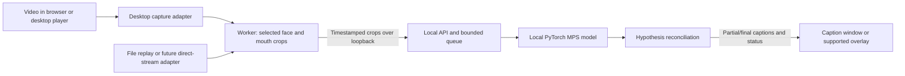

# You're Not on Mute — v0 implementation plan

Status: architecture and feasibility plan. Researched on 2026-10-31. The first runnable local preview and measured limits are documented in [v1.md](v1.md); targets below remain goals unless explicitly verified there.

## 1. Product goal and initial scope

Build an app that generates captions from the visible lip movements of a person in a video while that video is playing. The core capability is **visual speech recognition (VSR)**: it must work with the audio track absent. Receiving video continuously and emitting captions incrementally is a separate requirement from transcribing a completed video file.

The project started without application code. Use a **desktop app backed by a local Python inference service**, plus controlled video playback for development and evaluation. Develop and test the first working version on the user's Mac, preserving a cross-platform architecture for later ports. The user selects a window or screen region containing a playing video. The app processes the captured pixels independently of the browser, website, or media player.

The architecture should be **source-agnostic**: capture adapters produce timestamped frames for a shared recognition pipeline. Desktop capture is the first product adapter; file replay is the evaluation adapter. Direct streams and optional browser integrations can use the same engine later. Cross-platform architecture does not mean every OS/application combination works without validation.

Confirmed priority: **English is the first language to implement and validate.** Keep the multilingual interfaces, but defer additional language models and language-specific training until the English streaming pipeline passes its gates.

Confirmed environment: **development and testing use this machine, including inference.** The first working version targets this Mac; no hosted GPU or remote inference service is required by the plan.

Remaining planning assumptions, to revisit after the feasibility milestone:

- Enable additional languages only after verifying suitable visual-only models, deployment rights, and per-language quality/latency.
- One user-selected, visible speaker at a time, at normal playback speed.
- Unprotected video visible in a browser or desktop player, including live streams and prerecorded videos being streamed. Begin with frontal talking-head material: interviews, lectures, and presentations.
- Validate macOS on this machine first. Windows and Linux are later ports with separate hardware and compatibility gates. Keep OS-specific behavior behind adapters.
- Users explicitly start each capture session. Frames, mouth crops, and recognition remain on this machine; initial dependency/model downloads are separate from runtime processing.
- Several seconds of caption delay are acceptable for the first prototype. Subsecond captions are a later research target.

### User flow

1. Open a video in a browser or desktop player and click **Start lip reading** in the app.
2. Grant screen-capture permission, select a window or display, then select the video region and, if needed, the face to follow.
3. See capture quality, connection state, provisional captions, and finalized captions in a separate caption window. Offer a floating caption overlay where the OS/window mode supports it.
4. See explicit states such as “Face not visible,” “Video too blurry,” or “Reconnecting” when recognition cannot proceed.
5. Stop capture at any time. Optionally export the session transcript with approximate segment timestamps.

### Outside v0

Mobile apps, DRM-protected playback, guaranteed support for every application or OS, simultaneous speakers, translation, voice synthesis, identity recognition, cloud deployment, and training a foundation model from scratch. Audio-assisted transcription can be a later, separately labeled mode; it must not substitute for validating lip reading.

## 2. Feasibility comes before product polish

Lip movements do not uniquely determine every spoken sound. Camera angle, occlusion, editing, resolution, facial hair, and the model's language coverage can all affect usefulness. Treat output as uncertain generated captions, and measure when the system should abstain.

Use existing visual-only model checkpoints before considering training. Auto-AVSR's authors report 20.3% word error rate (WER) on LRS3, but that benchmark result is neither a streaming result nor a forecast for arbitrary browser video. Its repository supplies inference tutorials and uses PyTorch. [Auto-AVSR repository](https://github.com/mpc001/auto_avsr), [Auto-AVSR paper](https://arxiv.org/abs/2303.14307).

| Candidate | Planned role | Decision constraint |
| --- | --- | --- |
| Auto-AVSR visual-only checkpoint | First offline baseline; then test bounded rolling-window inference | Verify checkpoint-specific rights, preprocessing, memory, and latency before adopting it |
| AV-HuBERT | Optional research comparison if its terms fit the experiment | Repository is archived and its license grants noncommercial research use; do not make it the default product dependency |
| Causal/chunk-trained visual model | Follow-up if rolling windows fail latency or accuracy gates | Requires a separate research and data budget; not an assumed property of either baseline |

Auto-AVSR's code is Apache-2.0, while its pretrained models can have separate terms derived from training datasets. Record code, weights, tokenizer, face-model, and dataset permissions independently; an open code license does not resolve deployment rights. [Auto-AVSR license notes](https://github.com/mpc001/auto_avsr#license). AV-HuBERT's archive status and research restriction are documented by its maintainers. [Repository](https://github.com/facebookresearch/av_hubert), [license](https://github.com/facebookresearch/av_hubert/blob/main/LICENSE).

**First decision gate:** demonstrate useful visual-only output on representative video, confirm a usable model licensing path, and measure streaming performance. If this fails, narrow the supported content or fund a model research phase before promising a general-purpose app.

### Multilingual design and rollout

Capture, transport, and session management can be shared across languages. Recognition depends on the selected model's training, tokenizer, decoder, and language coverage; an English checkpoint does not become multilingual by changing the interface language. Client preprocessing must still match the selected checkpoint.

- Ask the user to select the spoken language when starting a session. Keep spoken language, interface language, and any future translation target as separate settings. Automatic visual language identification and speech that switches languages within an utterance require separate validation and are outside the initial pilot.
- Maintain a model registry declaring supported language tags, input modality, checkpoint/tokenizer hashes, preprocessing contract, streaming settings, licensing status, and evaluation status. Route a session either to a language-specific checkpoint or to a validated multilingual checkpoint with its required language conditioning.
- Resolve the model and preprocessing contract before the client sends mouth crops. Reject unsupported language requests explicitly. Changing language/model starts a new epoch and clears decoder context; never silently fall back to English.
- Use Unicode throughout captions and export. Support right-to-left text, mixed-direction punctuation, appropriate fonts, and grapheme-safe line wrapping. Test rendering using synthetic fixtures even before a language's recognition model is ready.
- Keep model pools bounded and expose loading status. Multiple language-specific models can increase GPU memory and cold-start time; benchmark the intended language mix rather than assuming English-only concurrency figures carry over.

There are concrete research candidates: ViSpeR's authors describe visual speech recognition data and models for English, Arabic, Chinese, French, and Spanish. This makes it a candidate to investigate, not a commitment to ship all five languages or an assertion of live-stream performance. Verify downloadable artifacts, actual visual-only inference, licenses, and reproducibility before selection. [ViSpeR repository](https://github.com/YasserdahouML/visper), [paper](https://arxiv.org/abs/2406.00038).

MuAViC provides audio-visual data in nine languages and is another possible evaluation/training resource. Dataset coverage does not establish that a deployable, accurate visual-only checkpoint exists for each language. [MuAViC repository](https://github.com/facebookresearch/muavic).

Roll out English first, then one product-priority language through the same capture/protocol/UI path to validate the abstraction. Each additional language needs held-out speaker data, suitable text normalization and WER/CER tokenization, abstention/false-speech evaluation, streaming latency measurements, and native-speaker review. Report results separately by language and relevant dialect; do not hide weak languages in an aggregate average. Languages without a suitable checkpoint may require licensed data collection and fine-tuning as a separate workstream.

Translation remains a later stage after source-language recognition. Translating an English decoder's output cannot recover speech originally spoken in a language that decoder cannot recognize. The delivery estimate below covers the English pilot and multilingual infrastructure; additional language validation or training needs separate estimates.

## 3. Recommended technology stack

These are proposed choices, not installed dependencies. Pin exact versions and model hashes after the baseline works; keep research dependencies isolated from the product runtime.

| Layer | v0 choice | Reason |
| --- | --- | --- |
| Client | Electron, TypeScript, React, Vite, npm | Desktop shell, shared UI, and caption windows without requiring a browser extension |
| Capture | Electron `desktopCapturer` / display media capture behind a `VideoSource` adapter | Start with window/display capture; isolate platform-specific implementations |
| Frame preprocessing | MediaPipe Face Landmarker, Web Worker, Canvas/OffscreenCanvas | Detect landmarks, follow the selected face, and create mouth crops locally |
| Live transport | Authenticated loopback WebSocket; binary crops and JSON control/results | Simple local process boundary; no media leaves the machine |
| API/session service | Python, FastAPI, Pydantic, Uvicorn | Session admission, schema validation, WebSocket lifecycle, health endpoints |
| Inference | Native macOS ARM64 PyTorch with MPS; explicit CPU diagnostic mode | Use the M1 Pro GPU through Metal; verify the selected checkpoint's operator support |
| Offline media/evaluation | FFmpeg, PyAV, NumPy, checkpoint reference preprocessing, jiwer | Decode timestamped fixtures and measure recognition quality reproducibly |
| Packaging | Electron Forge; project-local, locked Python environment | Run the Python service natively on macOS for MPS; desktop distribution packaging follows local validation |
| Persistence | In-memory session buffers; app-local settings | No database or retained video required for v0 |
| Quality checks | pytest, Vitest, Playwright, Ruff, ESLint/TypeScript checks | Cover temporal correctness, model regressions, and desktop/player workflows |
| Operations | Structured metrics/logs, local process health checks, one model worker | Observe latency, shared-memory pressure, errors, and capacity on this Mac |

### Verified local development baseline

Hardware inspection and a small tensor smoke check on this machine established:

- MacBook Pro with Apple M1 Pro: 8 CPU cores, 14 GPU cores, and 16 GB unified memory.
- macOS 15.6.1, ARM64; Python 3.12.3, PyTorch 2.7.1, Node.js 24.11.0, and FFmpeg available.
- The installed PyTorch build has MPS support. MPS was unavailable inside the command sandbox, but available outside it, where a small GPU matrix multiplication completed successfully. This verifies device access, not lip-reading model compatibility or performance.
- `pnpm` and `uv` were not on PATH during inspection. Set up project-local tooling as needed; do not replace the user's existing Python/PyTorch environment. Select the project's Python and PyTorch versions based on checkpoint compatibility.

Use PyTorch's `mps` device as the first acceleration path. Its backend maps supported operations to Apple's Metal implementation. Model-specific operators, numerical behavior, and decoder performance still require validation. [PyTorch MPS documentation](https://docs.pytorch.org/docs/stable/notes/mps.html).

Run inference as a native macOS process. Adapt hardcoded CUDA/device assumptions in the model adapter, compare a short CPU reference with MPS output, and record any unsupported operators. CPU fallback must be explicit and measured; an available MPS device does not mean the whole model executes on the GPU. PyTorch provides an opt-in fallback setting for unsupported MPS operations. [MPS environment settings](https://docs.pytorch.org/docs/stable/mps_environment_variables.html).

Load one English model and process one stream initially. The 16 GB memory is shared by the OS, desktop app, video player, CPU, and GPU; it is not a dedicated 16 GB inference budget. Measure memory pressure, swap activity, thermal slowdown, and sustained speed with playback and capture running together. Keep CPU mode for diagnostics until its throughput is measured. If this Mac misses the streaming gates, optimize or change the model and report the remaining gap rather than silently moving work to the cloud.

Choose Electron initially for its documented desktop capture API and a consistent JavaScript processing environment. It embeds Chromium internally, but users can keep watching in Safari, Firefox, Chrome, or a native player; capture does not depend on those applications exposing a browser extension API. The tradeoff is desktop package size and memory. Reconsider Tauri or native shells after measuring those costs and validating a continuous capture implementation, rather than assuming screenshot plugins provide a suitable video pipeline. [Electron desktop capture](https://www.electronjs.org/docs/latest/api/desktop-capturer).

Keep Kubernetes, Redis, a persistent database, WebRTC transport, and ONNX/TensorRT conversion out of the initial critical path. Add them only for a measured scaling, latency, or deployment requirement. A browser-only WebGPU model would be a separate optimization project requiring export, accuracy, memory, and device-coverage validation.

## 4. Architecture and capture strategy



### Source adapters

Define a `VideoSource` contract with `start`, `stop`, a bounded frame stream, and events for ended capture, permission loss, size changes, and discontinuities. Frames carry capture time, optional media time, dimensions, pixel format, source epoch, and an explicit resource-release mechanism. Advertise capabilities such as media-clock access or seek events; the recognition engine must not assume them.

| Adapter | Scope | Benefit and limitation |
| --- | --- | --- |
| Desktop window/display capture | v0 product | Works from rendered pixels across applications; permissions and usable capture vary by OS and application |
| Local file/replay | v0 evaluation | Reproducible frames and timestamps; can run paced to simulate streaming |
| Direct HLS/DASH/RTSP input | Later | Can avoid screen scaling and expose media timestamps; requires an accessible, authorized, unprotected source and protocol-specific decoding |
| Browser extension/player integration | Optional later | Adds precise player events and tab selection; never required by the core engine |

### Desktop responsibilities

- Start video-only capture after explicit user selection. Electron exposes window and screen sources; macOS requires screen-capture consent, and its PipeWire path on Linux has source-selection constraints. Validate the pinned runtime on target systems. [Electron capture API and caveats](https://www.electronjs.org/docs/latest/api/desktop-capturer).
- Let the user crop within the selected source. Distinguish display coordinates from source pixels, account for scaling and multiple monitors, and revalidate the crop on size changes. Prefer selected-window capture to collecting an entire display when supported.
- Keep capture and preprocessing independent of caption-window rendering. Benchmark throttling when the app is unfocused or its UI is hidden. Capture APIs provide a media stream; do not poll source thumbnails as video frames.
- Treat covered, minimized, closed, or moved windows and background browser tabs as compatibility cases. Do not promise capture of hidden video. Screen-region capture can include other windows covering the target; pause or request reselection if the intended content is lost.
- Use a regular caption window as the fallback. Test floating/click-through overlays, fullscreen spaces, and exclusive fullscreen separately. Keep captions outside the captured mouth region and exclude the app's windows where supported to prevent feedback.
- Keep the desktop renderer sandboxed with context isolation and Node integration disabled. Use a narrow, validated preload/IPC interface for capture controls; load the app's own UI instead of embedding arbitrary streaming websites. [Electron security guidance](https://www.electronjs.org/docs/latest/tutorial/security).
- On stop, permission revocation, screen lock, or source loss, terminate capture, clear pending frames, and reset the inference epoch. Show unsupported capture explicitly rather than trying to bypass protection.

### Platform validation

| Platform | Capture direction | Release checks |
| --- | --- | --- |
| macOS | Electron capture first; native ScreenCaptureKit adapter if required by measured limitations | Permission grant/revocation, Retina scaling, multiple displays, fullscreen spaces, signed/notarized build |
| Windows | Electron capture first; native Windows.Graphics.Capture adapter if required | DPI scaling, application-window capture, hardware-accelerated players, fullscreen, installer signing |
| Linux | Validate Electron's PipeWire path on Wayland; test X11 independently | Portal availability, compositor differences, picker cancellation, caption-window positioning |

Only the macOS row is in the first working version's validation scope. Windows/Linux work and public-release signing/notarization are later milestones; do not claim those platforms have been tested from this Mac.

Native adapter options are grounded in the platform interfaces: [Apple ScreenCaptureKit](https://developer.apple.com/documentation/screencapturekit), [Windows capture](https://learn.microsoft.com/en-us/windows/apps/develop/media-authoring-processing/screen-capture), and [XDG ScreenCast portal/PipeWire](https://flatpak.github.io/xdg-desktop-portal/docs/doc-org.freedesktop.portal.ScreenCast.html). Do not assume Electron uses the same backend on every runtime/OS version.

A browser-only demo using `getDisplayMedia()` is also possible without installing an extension. It still requires user-selected screen sharing and browser support, and needs a separate solution for captions above another application. Keep this as an optional client of the same pipeline. [W3C screen-capture specification](https://www.w3.org/TR/screen-capture/).

The controlled test player should play local fixtures and an owned, unprotected streaming fixture. This provides known media timestamps, pause/seek events, and repeatable live playback. Provider-specific integrations are optional; the primary product reads captured pixels without extracting provider URLs.

## 5. Video-to-text pipeline

### A. Capture, tracking, and quality

1. Receive frames with monotonic capture timestamps. Preserve source media timestamps separately where the player exposes them; screen-capture time alone is not the original video's time.
2. Detect faces in the selected video region, ask the user to select a face when ambiguous, and maintain a session-local track. Reset on scene cuts, lost tracking, or speaker changes; never concatenate different people's mouth sequences.
3. Estimate landmarks, align the face, crop the mouth, and apply the checkpoint's exact resize, color, normalization, and temporal sampling rules. Derive these from the selected checkpoint rather than assuming a universal crop size or frame rate.
4. Prototype approximately 25 frames/second only if compatible with that checkpoint. Resample by timestamps, record duplicates/drops, and reject large gaps. Smooth crop movement without erasing lip motion.
5. Gate poor input using measured mouth resolution, blur, pose, occlusion, and track stability. Calibrate thresholds on the evaluation set. Mouth movement alone is not reliable evidence that someone is speaking.

MediaPipe's web landmark detection calls are synchronous; run them in a worker so they do not block the interface. It supplies face landmarks, not speech recognition. Compare its crops against reference model preprocessing on identical clips before replacing the reference cropper. [MediaPipe web guide](https://developers.google.com/edge/mediapipe/solutions/vision/face_landmarker/web_js).

### B. Transport and buffering

- Send mouth crops rather than full window/display images. Begin with packed 8-bit grayscale pixels if the checkpoint uses grayscale, in batches of roughly 100–200 ms; otherwise retain its required channels.
- For scale, a hypothetical 96 × 96 grayscale crop at 25 fps is about 230 KB/s, or 1.84 Mbit/s before protocol overhead. Treat compression as a measured bandwidth/accuracy tradeoff; avoid base64 image payloads.
- Maintain bounded capture, network, and inference queues. Monitor `bufferedAmount`, oldest queued timestamp, and processing time. Stop admitting sessions when capacity is exhausted.
- Under overload, discard a stale contiguous interval and emit a gap/reset rather than silently changing the model's temporal sampling. Never accumulate minutes of delayed captions.
- Clear buffers and reject obsolete responses after stop, seek, navigation, face changes, and reconnect. Release frame resources promptly.

### C. Streaming recognition

Begin by adapting an offline model to bounded rolling windows. This is an experiment, not a claim of native streaming support.

- Benchmark window lengths of 2, 4, 6, and 8 seconds with decode strides of 0.5–1 second; evaluate accuracy, context loss, compute, and delay together.
- Retain overlap across windows. Reconcile repeated hypotheses using token overlap and temporal evidence where available. Do not append whole window transcripts, which duplicates words.
- Emit revisable partial segments. Commit only a stable prefix observed across successive decodes, retaining an unstable suffix. Do not assume the checkpoint provides accurate word timestamps; start with approximate segment intervals.
- Add bounded endpoint/finalization behavior for pauses, tracking loss, and continuous speech. A long utterance must not prevent all final output, and a forced flush must not turn an unstable guess into confident text.
- Represent uncertain regions as unreadable or omit them with an explicit status. Raw decoder scores are not calibrated probabilities; validate any displayed confidence labels.
- Do not use a general LLM to invent or rewrite missing speech. Any future language-model rescoring must be evaluated for unsupported additions and kept traceable to recognition hypotheses.

Re-decoding a 6-second window every second can require about six times the per-stream work of a single offline pass. Measure sustained overlapping-window throughput rather than inferring live capacity from an isolated clip benchmark. If the quality/latency balance fails, evaluate causal or chunk-trained models before adding more application features.

#### Streaming performance decision

The architecture supports continuous input and incremental output, but no end-to-end performance has been measured in this project. Two independent conditions must pass: the pipeline must keep up with incoming video without accumulating work, and accurate captions must arrive soon enough to be useful. A system can satisfy throughput while still waiting too long for linguistic context.

Measure startup separately from steady-state behavior. A 6-second trailing window initially needs up to 6 seconds of context unless shorter initial windows work; after filling, it does not inherently add another 6-second wait to every update. Stable final captions can still require further observations and repeated decoding. Do not equate the caption update interval with recognition latency.

Instrument capture, preprocessing, upload, queue wait, model execution, hypothesis stabilization, and rendering. Use source timestamps carried through the pipeline and client-monotonic elapsed times for end-to-end measurements; do not subtract unsynchronized host clocks. Keep inference warm for admitted sessions and report cold model-loading time separately.

For a one-second decode stride, benchmark a provisional p95 model-execution budget of at most 700 ms, leaving scheduling headroom for other work. This is a target, not a measured capability. Also require stable queue age and frame coverage over a 30-minute run: p95 alone can hide recurring stalls, and dropping most input is not a throughput success. For example, a model that takes 1.5 seconds to process a 6-second clip is faster than the clip's playback, but cannot sustain reprocessing that window every second on one serial inference worker.

The first implementation milestone is an **English streaming feasibility harness**, before completing the desktop product:

1. Reproduce one English visual-only checkpoint on timestamped fixtures and record its offline quality.
2. Replay those fixtures at playback speed, allowing access only to frames already received; sweep the planned window lengths and strides on this M1 Pro using MPS, reporting any CPU fallback.
3. Measure partial/final caption lag, recognition error, startup delay, queue age, dropped intervals, and memory over a sustained run.
4. Add real desktop capture and loopback transport to check that client preprocessing and transport preserve the result, with all components and video playback running on this Mac simultaneously.
5. Proceed with the selected model only when accuracy, coverage, sustained throughput, and the provisional p95 targets of 3-second partial / 6-second final phrase-end lag pass together.

If compute is the bottleneck, benchmark supported reduced precision, decoder beam sizes, shorter windows, or a smaller checkpoint with accuracy regression checks. Cache overlapping model computation only when the model architecture permits equivalent reuse; a bidirectional encoder cannot automatically reuse all past representations unchanged. If required context is the bottleneck, faster hardware alone will not resolve it: evaluate a causal/chunk-trained visual model or revise the delay target explicitly.

### D. Caption presentation and timing

Show provisional and final text distinctly, with at most two caption lines and a readable history panel. Measure lag against when the source speech was played. For arbitrary third-party streams, captions will trail playback; do not imply timestamping eliminates that delay. A future owned-player mode can intentionally buffer playback for alignment.

Pause and seek integration should reset the stream epoch when available. Desktop capture normally lacks player events and media time: expose capture-relative timestamps and a manual reset, clear context on detectable discontinuities, and document that not every seek can be detected from pixels. Optional player adapters can improve this without changing the inference engine. Do not present approximate segment timing as word-level synchronization.

## 6. Service and protocol boundaries

Keep the model behind a replaceable adapter so capture and UI development can use a deterministic fake decoder.

```text
POST   /v1/sessions              -> short-lived session credential + stream URL
GET    /v1/capabilities          -> validated languages and model availability
WS     /v1/sessions/{id}/stream   -> visual batches in; captions/status out
DELETE /v1/sessions/{id}         -> stop processing and discard session buffers
GET    /health/live             -> service process health
GET    /health/ready            -> model loaded and service able to accept work
```

Session creation accepts `source_language` and `modality: visual_only`. Its response includes the selected model version, accepted language, preprocessing contract, and readiness/loading state. The client waits for readiness before sending frames. Unsupported languages return an explicit error rather than a substitute model.

Use a versioned protocol. Every visual batch includes `session_id`, `epoch`, `sequence`, `track_id`, per-frame capture timestamps, optional source media timestamps, crop shape/format, and preprocessing version. Enforce payload limits, timestamp monotonicity, sequence consistency, and supported formats.

Caption messages include `segment_id`, `revision`, `epoch`, approximate `start_ms`/`end_ms`, the timestamp basis, `text`, `language`, `is_final`, quality state, and model version. The client replaces an existing segment revision and ignores stale epochs. Include explicit `gap`, `reset`, `overloaded`, and `error` events.

For local development and testing, bind the service to `127.0.0.1`, never all network interfaces. The desktop app launches/supervises the Python process and passes a fresh local credential through a private process channel. Authenticate HTTP requests and the first WebSocket control message before accepting media, validate expected origins and session ownership, enforce payload/session limits, and keep credentials out of URLs and logs. No account service is needed. Keep inference off the API event loop in one model-loading worker with bounded queues, and stop the child process cleanly when the app exits. No persistent transcript store is needed initially.

## 7. Evaluation and acceptance criteria

Create a small, consented or appropriately licensed evaluation corpus before UI polish: initially 2–5 hours covering at least 20 speakers, with human-checked transcripts, segment timing, and quality annotations. Keep speakers disjoint across any tuning and held-out evaluation. Record known or uncertain overlap with checkpoint training data; a reused public benchmark is not proof of generalization.

Include frontal speech, moderate head turns, multiple visible faces, small mouths in the frame, variable bitrate/frame rate, scene cuts, pauses, occlusion, and nonspeech mouth movements. Keep difficult cases visible in reports instead of excluding them after seeing results. Do not feed reference transcripts, existing captions, or audio to the visual model.

Run each fixture both offline and paced as a live stream using only frames available at that time. Report warm and cold behavior, hardware, checkpoint hash, decoding parameters, network conditions, and per-condition results.

The following are **provisional go/no-go targets**, to confirm after the baseline; they are not achieved performance claims:

| Measure | Pilot target |
| --- | --- |
| Final visual-only recognition | WER ≤ 35% on the predeclared supported talking-head slice; also report character error rate and all difficult slices |
| Coverage and abstention | Produce captions for ≥ 80% of supported speech duration; count abstained speech as deletions in full-slice WER and report accepted-only WER separately |
| False speech | ≤ 1 falsely captioned segment per 10 minutes of annotated nonspeech/face-absent video |
| Partial-caption lag | p95 ≤ 3 seconds after the end of the corresponding reference phrase |
| Final-caption lag | p95 ≤ 6 seconds after reference phrase end, with bounded commits during long continuous speech |
| Streaming capacity | Sustain one 30-minute stream without growing backlog; p95 processing time per decode below its scheduled stride |
| Session correctness | No stale captions after reset/seek/stop; no duplicate finalized segments in scripted overlap cases |
| User value | At least 4 of 5 pilot users can follow a short supported clip and find the delay usable |

Measure lag using annotated reference phrases and transcript alignment, reporting alignment failures rather than dropping them. Track caption revision rate, queue age, frame gaps, CPU/GPU memory, and preprocessing time alongside WER. Tune confidence thresholds on development data, then evaluate once on the held-out split.

Automate meaningful checks for timestamp resampling, crop parity, overlap reconciliation, track changes, epoch handling, adapter conformance, and bounded queues. Exercise desktop workflows against the controlled player and manually verify actual OS capture permissions, multiple monitors, scaling, minimized/covered windows, source closure, and fullscreen. Test representative browsers and a native player on each supported OS. Run GPU regression fixtures when preprocessing, models, or decoding change. No implementation tests are required for this planning document itself.

## 8. Delivery sequence

Indicative schedule for one full-stack engineer and one ML engineer, with part-time product/testing support: approximately 8–10 weeks for a locally running macOS pilot if an existing checkpoint passes MPS compatibility and streaming feasibility. Re-estimate after the local model benchmark. Windows/Linux ports and public distribution are outside this schedule; model adaptation, acquiring data rights, or native capture work can extend it substantially.

| Phase | Approximate timing | Deliverables and exit gate |
| --- | --- | --- |
| 0. Baseline, capture, and rights | Week 1 | Evaluation manifest, model/asset rights record, CPU/MPS checkpoint parity, reproducible English visual-only inference, reference cropper, initial WER/memory measurements, and capture spike on this Mac. Stop product rollout if no usable local model path exists. |
| 1. Streaming feasibility | Weeks 2–3 | Real-time replay harness, window/stride comparison, stable caption reconciliation, latency and sustained-throughput report. Continue only if supported-content targets look achievable. |
| 2. End-to-end prototype | Weeks 3–5 | Controlled player, session API, desktop capture adapter, local mouth crops, caption window, stop/reset/reconnect. Verify client crops preserve baseline quality. |
| 3. Usability and reliability | Weeks 6–8 | Face selection, quality states, supported overlay, bounded queues, local service authentication/lifecycle, metrics, transcript export, reproducible local build, macOS/application compatibility matrix. Complete long-session tests. |
| 4. Pilot decision | Weeks 9–10 | Held-out evaluation and user sessions on this Mac, measured local resource/latency limits, documented limitations, and a decision to ship, narrow scope, or return to model work. |

The ML engineer owns model evaluation, preprocessing parity, decoding, and performance. The full-stack engineer owns capture, protocol, UI, and deployment. Share temporal correctness and integration testing; the model benchmark is the critical dependency.

### Proposed repository layout

```text
apps/
  desktop/               # Electron shell, source picker, caption window/overlay
  test-player/           # Repeatable playback and streaming fixtures
services/
  api/                   # Sessions, authentication, WebSocket lifecycle
  inference/             # Model adapter, preprocessing contract, decoder
packages/
  video-source/          # Frame contract, capture adapters, lifecycle events
  vision-client/         # Shared tracking, mouth crops, session transport
  protocol/              # Versioned schemas and example messages
evaluation/
  manifests/             # Rights/provenance and split metadata, not raw video
  replay/                # Paced visual-only benchmark runner
  reports/               # Quality, latency, resource, and compatibility results
infra/                   # Native local launch, environment, and packaging scripts
docs/
  v0.md
```

Keep checkpoints and raw datasets outside Git. Store model hashes, dependency locks, preprocessing configuration, and evaluation commands so results can be reproduced.

## 9. Data handling, operations, and cost

- Process window/display frames locally and pass only the selected mouth crop to the local inference service. Media and transcripts stay on this machine. Minimize their lifetime even on loopback.
- Keep rolling media buffers in memory, bounded by the configured inference context. Delete session buffers on stop, timeout, or disconnect cleanup. Do not retain video or transcripts server-side by default, including in logs and crash reports.
- Export transcripts only on user action. Make any future diagnostic recording a separate opt-in with a defined deletion period.
- Record operational metrics without raw frames, caption text, or visited page URLs: queue age, processing latency, resource use, resets, failures, and active sessions.
- Run one warm MPS inference worker and a lightweight local API. Admit one stream initially and explicitly reject excess sessions rather than allowing unbounded latency.
- Track model/dependency disk footprint, application and model memory, CPU/GPU load, swap pressure, thermal effects, and battery/power conditions alongside caption lag. Benchmark one continuous stream with the video player active. Cloud costs, remote capacity, and multi-stream scaling are outside the local v1 plan.

## 10. Main risks and decision points

| Risk | Planned response |
| --- | --- |
| Visual ambiguity or poor real-world accuracy | Narrow initial content, show uncertainty, measure abstention and false speech, validate usefulness with users |
| Offline model cannot meet live latency | Measure rolling-window overhead early; use a dedicated causal-model research phase if needed |
| Model or dataset terms prevent intended deployment | Maintain asset provenance; obtain suitable rights or select/train an alternative before release |
| Client preprocessing changes model inputs | Compare against the reference cropper before enabling client-side preprocessing in the pilot |
| Captured video has unusable mouth detail | Quality gate and user guidance; test actual streamed compression and layout conditions |
| OS capture differences, unsupported/protected players, or fullscreen behavior | Publish an OS/application compatibility matrix, use a separate caption-window fallback, and show unsupported capture clearly |
| Captions drift, duplicate, or survive a seek | Explicit clocks/epochs, revisioned segments, overlap tests, and resets |
| MPS incompatibility or insufficient local memory/throughput | Check operator support and CPU/MPS parity early, profile fallback, bound memory, and evaluate smaller models or alternate local runtimes if necessary |

English and development/testing on this Mac are confirmed. Before committing to a public release, confirm priority video applications, acceptable measured caption delay, distribution requirements, and any later platform/language expansion. The local feasibility work can proceed with the decisions already made.
